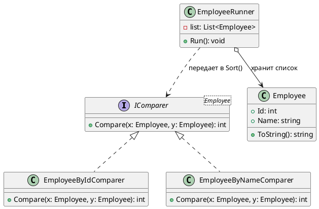
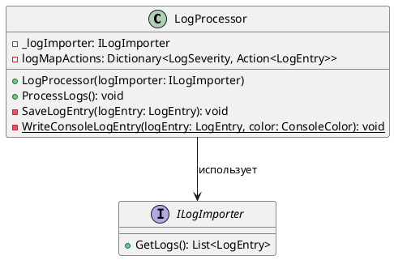
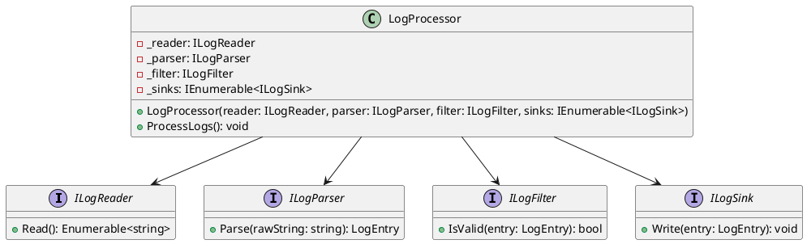

# Лабораторная работа 4. Git, среда и SOLID

**Студент:** Гареева Елизавета, БИСО-01-24  
**Вариант:** 10  
**Репозиторий:** https://github.com/lizagareewa/lr4-8.git  
**Pull Request:** https://github.com/lizagareewa/lr4-8/pull/1

## Задача
Настроить рабочее окружение, создать базовый каркас системы LogHub и настроить непрерывную интеграцию (CI) через GitHub Actions. Провести рефакторинг исходного "божественного объекта" (`LogProcessor`), разделив его на независимые слои для соблюдения принципов SOLID (в частности SRP, OCP и DIP). Дополнительно — изучить и описать реализацию одного из паттернов в чужом коде.

## Диаграмма классов

### 1. Чужой код (Паттерн Strategy)


### 2. До рефакторинга («Божественный объект»)


### 3. После рефакторинга (Соблюдение SOLID)


## Применённые паттерны

| Паттерн | Где применён | Почему именно он |
| :--- | :--- | :--- |
| **Strategy (Стратегия)** | Абстракция вывода логов (`ILogSink` и реализация заглушек для тестирования) | Позволяет избавить `LogProcessor` от жесткой привязки к конкретному приёмнику. Если в будущем потребуется выводить логи в файл (как требует 10 вариант), достаточно написать новую стратею, не меняя код самого процессора. Это напрямую решает проблему нарушения принципа OCP, так как избавляет от операторов `switch` по типу приёмника. |

## Ключевые решения

*   **Разделение ответственности (SRP):** Процесс разделен на независимые логические слои (интерфейсы `ILogReader`, `ILogParser`, `ILogFilter`, `ILogSink`). Класс `LogProcessor` избавлен от деталей реализации и теперь выступает исключительно в роли маршрутизатора.
*   **Инверсия зависимостей (DIP):** Класс процессора зависит только от абстракций (интерфейсов). Это позволило написать полностью изолированные юнит-тесты с использованием Mock-объектов без обращения к реальному диску или системной консоли.

## Тесты

```text
$ dotnet test
Сводка теста: всего: 6; сбой: 0; успешно: 6; пропущено: 0; длительность: 2,5 с
Сборка успешно выполнено через 11,9 с
```

## Что не получилось

Больше всего времени заняла первоначальная настройка окружения и CI пайплайна:
1.  Из-за конфликта разрядности .NET SDK терминал выдавал ошибку `No .NET SDKs were found`. Проблема решилась переустановкой версии x64 и правкой переменных сред.
2.  Вкладка GitHub Actions оставалась пустой после отправки конфигурации, потребовался пустой коммит (`git commit --allow-empty`), чтобы принудительно инициировать запуск пайплайна в форкнутом репозитории.
3.  Возникла небольшая путаница с тем, как именно GitHub рендерит диаграммы PlantUML — оказалось, что для браузера преподаватель использует специальный плагин, поэтому вставлять нужно именно код ````plantuml````, а не готовые картинки.

## Источники

*   Исходный репозиторий преподавателя: https://github.com/clgray/Lecture_Examples.git
*   Методичка с заданием: Практикум 
*   Официальная документация Microsoft по .NET SDK (разрешение конфликтов переменных среды PATH).
*   Документация GitHub Actions (раздел Workflow syntax).