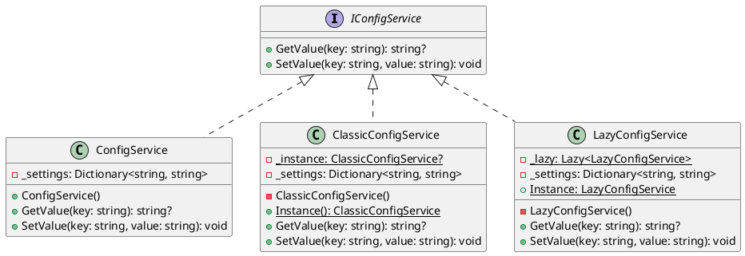

# Лабораторная работа 5. IoC, DI-контейнер и Синглтон

**Студент:** Гареева Елизавета, БИСО-01-24  
**Вариант:** 10  
**Репозиторий:** https://github.com/lizagareewa/lr4-8.git  
**Pull Request:** 

## Задача
Реализовать сервис конфигурации тремя различными способами (обычный класс, классический Синглтон, Lazy-Синглтон). Воспроизвести на тестах проблему разделяемого состояния, которую создает классический Синглтон. Настроить DI-контейнер (Microsoft.Extensions.DependencyInjection), собрать композиционный корень приложения и реализовать подмену профиля логирования без перекомпиляции программы.

## Диаграмма классов



## Применённые паттерны

| Паттерн | Где применён | Почему именно он |
|---|---|---|
| **Singleton (Одиночка)** | В классах `ClassicConfigService` и `LazyConfigService`. | Требовалось продемонстрировать разницу между глобальной точкой доступа и управлением временем жизни объекта. Паттерн применен в учебных целях для демонстрации того, как разделяемое статическое состояние ломает независимость юнит-тестов. |
| **Dependency Injection (Внедрение зависимостей)** | Композиционный корень в `Program.cs`. | Избавляет классы (например, `LogProcessor`) от необходимости самостоятельно создавать свои зависимости (`new`). Позволяет легко переключать профили конфигурации (console/file) и делает код полностью тестируемым. |

## Ключевые решения

**Отличие паттерна Singleton от регистрации AddSingleton в контейнере:**
Паттерн Singleton (классический) предоставляет *глобальную точку доступа* (статический метод `Instance()`). Из-за этого состояние объекта становится общим для всего приложения и переносится между тестами. В тесте `ClassicSingleton_Test2_ExpectsCleanState` мы это доказали: если запустить его после первого теста, он падает, так как читает данные, записанные предыдущим тестом.

При использовании `AddSingleton` в DI-контейнере объект живет в единственном экземпляре *только в рамках одного контейнера*. При тестировании мы можем создать для каждого теста свой изолированный класс `ConfigService` (что показано в `NormalConfig_Test2`), избежав статического мусора. Глобального состояния нет, класс остается тестируемым.

## Тесты

```text
$ dotnet test
Сводка теста: всего: 10; сбой: 0; успешно: 9; пропущено: 1
Сборка успешно выполнено через 7,3 с
```
Тест ClassicSingleton_Test2_ExpectsCleanState помечен атрибутом [Fact(Skip="...")] (аналог Ignore в xUnit). Это сделано намеренно по заданию: тест нужен для демонстрации проблемы синглтона. Если снять пропуск, он падает в общем наборе тестов из-за сохранившегося статического состояния от предыдущего теста, но проходит успешно при одиночном запуске. Пропуск оставлен, чтобы CI-пайплайн горел зелёным.

## Что не получилось

1. Изначально было сложно понять, как именно вручную настраивать DI-контейнер в обычном консольном приложении. Потребовалось время, чтобы разобраться в цепочке вызовов `ServiceCollection` -> `BuildServiceProvider()` и понять, как правильно использовать `GetRequiredService` только один раз для получения корневого объекта.
2. Возникла небольшая путаница при выборе времени жизни зависимостей при регистрации в контейнере: пришлось дополнительно почитать документацию, чтобы понять разницу между `AddTransient` и `AddSingleton` для слоёв парсинга и фильтрации логов.
3. Потребовалось время на поиск способа пропуска тестов в используемом фреймворке xUnit: оказалось, что вместо стандартного атрибута `[Ignore]` необходимо использовать параметр `Skip` напрямую внутри атрибута `[Fact]`.

## Источники

* Учебник, глава «IoC и внедрение зависимостей».
* Практикум, требования к ЛР 5.
* Официальная документация Microsoft по DI-контейнеру (Microsoft.Extensions.DependencyInjection).